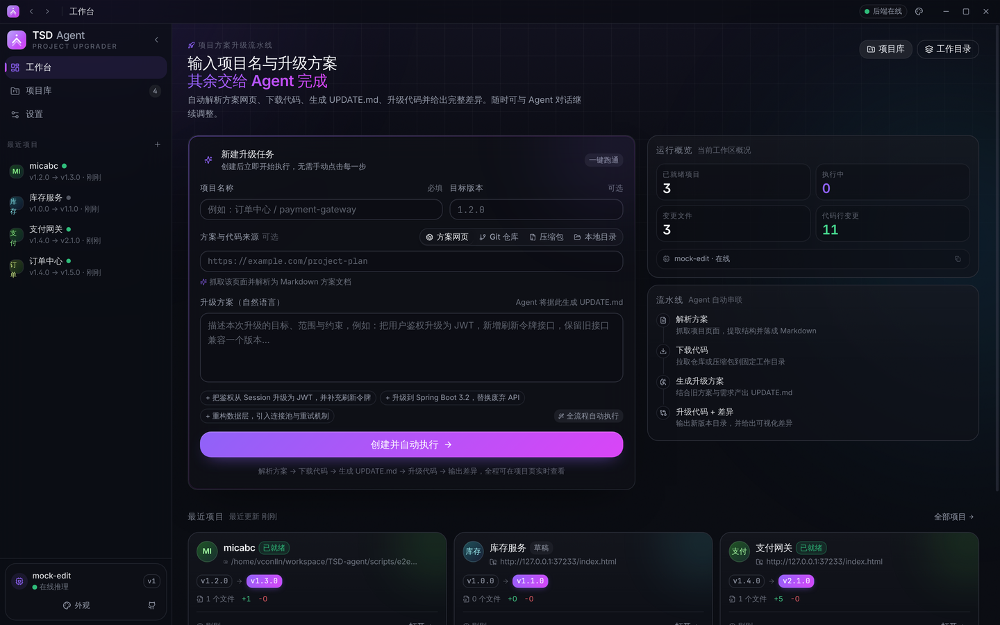
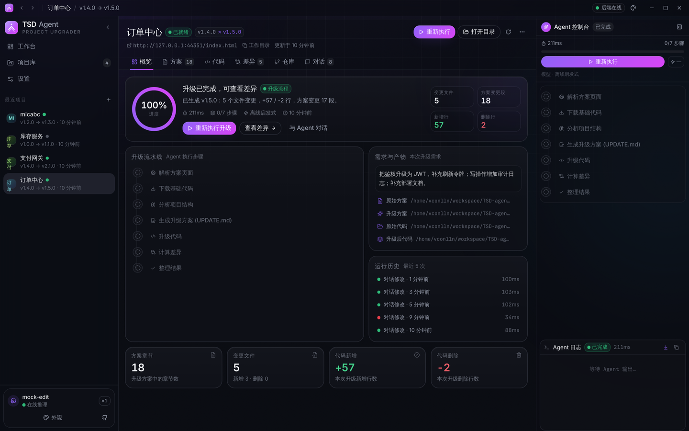
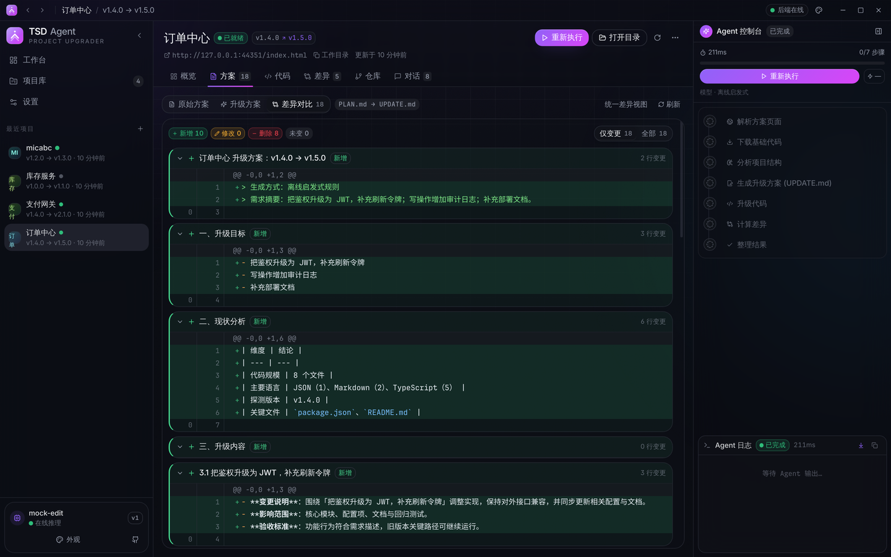
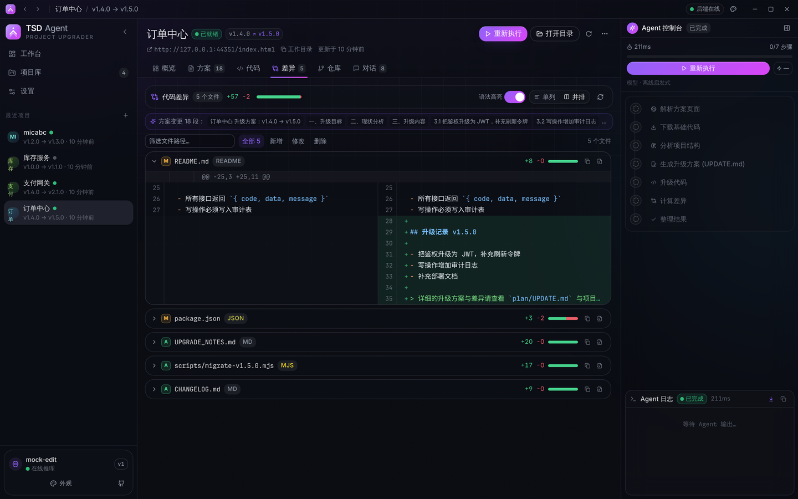
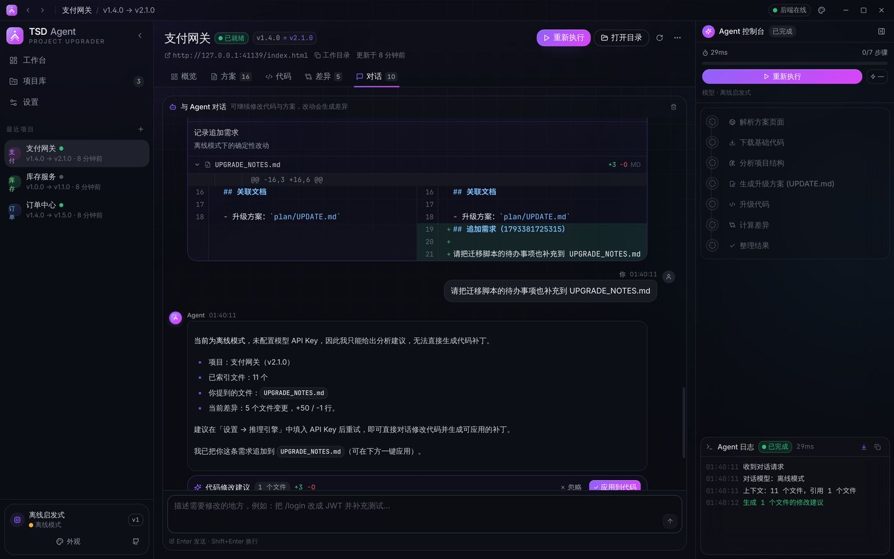
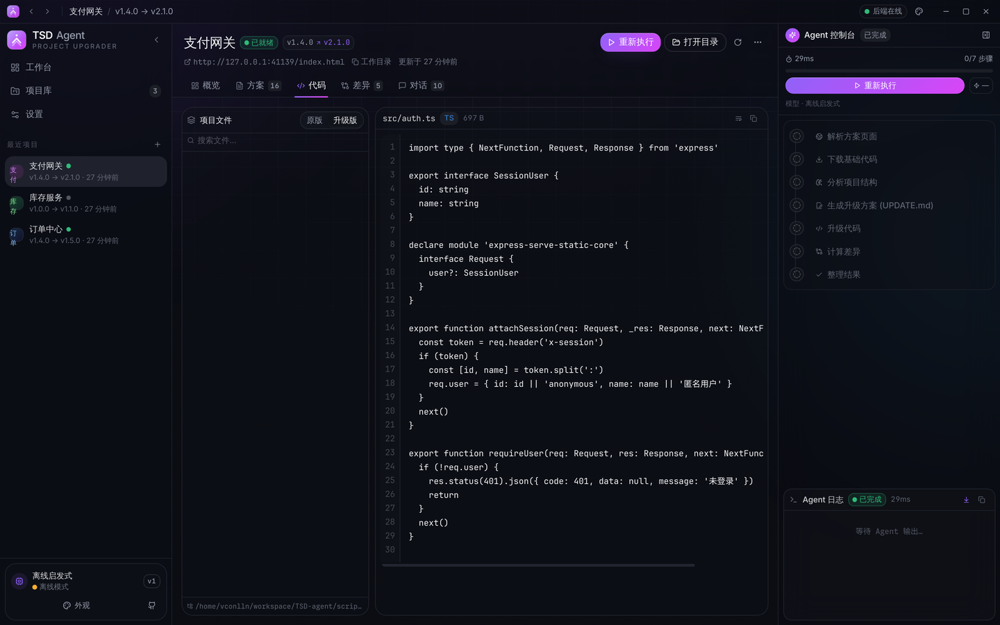
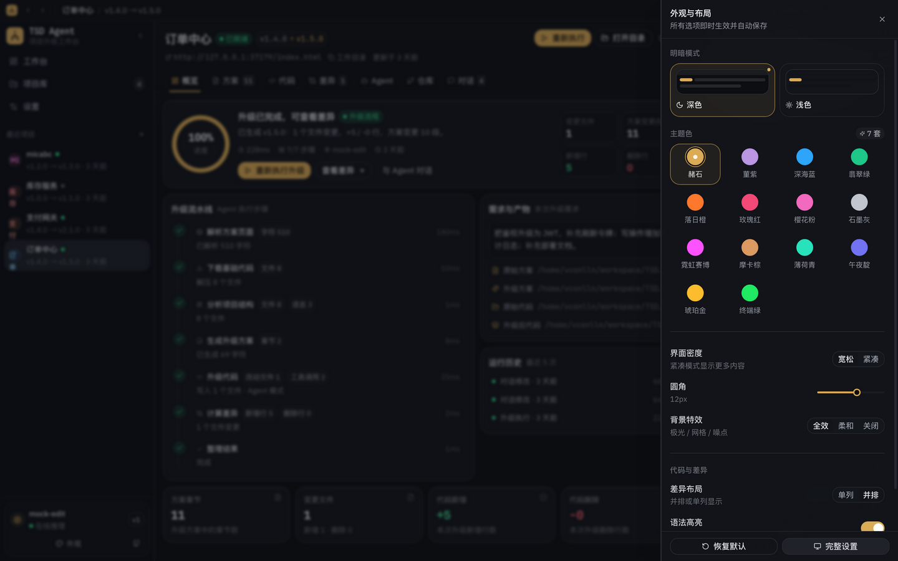
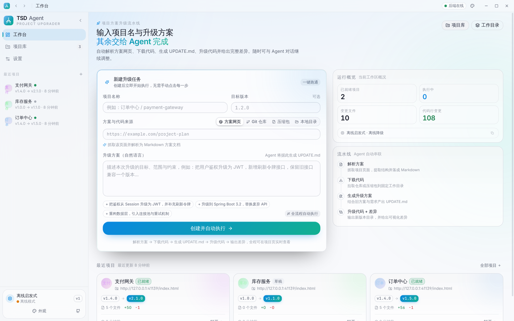

<div align="center">

# TSD Agent

**项目方案升级智能体 · 桌面客户端**

输入「项目名 + 升级方案」，自动完成：解析方案页面 → 下载代码 → 生成 UPDATE.md → 升级代码 → 输出可视化差异 → 对话继续改代码。

Electron · React 18 · TypeScript · Tailwind · Radix UI · FastAPI · SSE

</div>

---

## ✨ 它解决什么问题

真实项目升级往往是这样一堆碎活儿：翻方案网页、抄要点、拉代码、写升级文档、改代码、比对差异、再跟人解释改了哪里。
TSD Agent 把这条链路交给一个自动化的 Agent 流水线，你只需要两样输入：

1. **项目名**
2. **升级方案（自然语言）**

剩下的每一步都会在界面上实时可见、可中断、可回溯，最后拿到三样交付物：

| 产物 | 位置 | 说明 |
| --- | --- | --- |
| `PLAN.md` | `<workspace>/projects/<id>/plan/PLAN.md` | 从方案页面解析出的结构化方案 |
| `UPDATE.md` | `<workspace>/projects/<id>/plan/UPDATE.md` | 结合需求与现状生成的升级方案 |
| `{项目名}_{新版本}/` | `<workspace>/projects/<id>/v{新版本}/` | 升级后的完整代码目录 |

---

## 🚀 核心能力

- **一条龙流水线**：解析页面 → 下载代码 → 分析结构 → 生成方案 → 升级代码 → 计算差异，全部由 Agent 自动串联。
- **实时可观测**：7 个步骤带进度与耗时；SSE 推送日志与事件，运行中可随时停止，刷新页面可续传事件流。
- **差异即交付物**
  - 方案差异：按章节对比新增 / 修改 / 删除，支持整篇统一差异视图。
  - 代码差异：文件树 A/M/D 标记、行级 `+/-` 统计、单列 / 并排两种布局、词级高亮、语法着色、超大文件折叠。
- **对话式迭代**：输出完成后继续和 Agent 对话，它会给出**可审阅的补丁建议**，你点「应用到代码」才会真正落盘，差异随即刷新。
- **7 套主题 × 深浅模式**：极光紫、深海蓝、翡翠绿、落日橙、玫瑰红、樱花粉、石墨灰；密度、圆角、背景特效、代码换行、差异布局全部可调，实时生效并持久化。
- **后端可替换**：前端只依赖一套 HTTP + SSE 契约（见 [docs/API.md](docs/API.md)）。既可以用随包分发的参考后端，也可以在设置里连接**你自己的 Python 服务**。
- **三种代码来源**：方案网页 / Git 仓库 / 代码压缩包 / 本地目录，页面里还能自动发现 GitHub 或 zip 链接。
- **离线可跑**：没配 API Key 时自动降级为离线启发式模式，流程依然完整，方便先验证链路再接模型。

---

## 🧩 界面速览

<table>
  <tr>
    <td width="50%"></td>
    <td width="50%"></td>
  </tr>
  <tr>
    <td align="center"><sub>工作台 · 一条表单启动全流程</sub></td>
    <td align="center"><sub>项目概览 · 流水线 / 进度环 / 变更统计</sub></td>
  </tr>
  <tr>
    <td width="50%"></td>
    <td width="50%"></td>
  </tr>
  <tr>
    <td align="center"><sub>方案差异 · 章节级增删改</sub></td>
    <td align="center"><sub>代码差异 · 并排 / 单列 + 语法着色</sub></td>
  </tr>
  <tr>
    <td width="50%"></td>
    <td width="50%"></td>
  </tr>
  <tr>
    <td align="center"><sub>对话修改 · 可审阅补丁，一键应用</sub></td>
    <td align="center"><sub>代码浏览 · 原版 / 升级版切换</sub></td>
  </tr>
  <tr>
    <td width="50%"></td>
    <td width="50%"></td>
  </tr>
  <tr>
    <td align="center"><sub>外观面板 · 7 套主题 / 密度 / 圆角 / 特效</sub></td>
    <td align="center"><sub>浅色模式 + 深海蓝</sub></td>
  </tr>
</table>

> 截图由 `npm run screenshots` 在无头 Electron 中真实渲染生成（离线模式数据），
> 不是设计稿。右上角调色板按钮或 `Ctrl/Cmd + J` 可打开外观面板。

---

## ⚡ 快速开始（开发模式）

### 环境要求

- Node.js **18+**（推荐 20/22）
- Python **3.10+**

### 1. 安装依赖

```bash
npm install
python -m venv .venv
source .venv/bin/activate        # Windows: .venv\Scripts\activate
pip install -r server/requirements.txt
```

### 2. 启动

```bash
# 终端 A：启动 Python 后端（前端会读取它）
python server/main.py --port 8791

# 终端 B：启动桌面应用（自动拉起 Vite + Electron）
npm run dev
```

Electron 主进程内置了后端守护：开发模式下若 `server/main.py` 存在，会自动用系统 Python 启动它，无需手动开两个终端。

### 3. 配置模型（可选）

打开「设置 → 推理引擎」，填入任意 **OpenAI 兼容**接口：

| 项 | 示例 |
| --- | --- |
| 接口地址 | `https://api.deepseek.com/v1` |
| 模型 | `deepseek-chat` |
| API Key | `sk-...` |

不配置也能用：后端会进入离线启发式模式。

---

## 📦 打包成 exe 安装包

> 目标：`TSD-Agent-Setup-1.0.0.exe`（NSIS 安装包，内置 Python 后端，用户无需安装 Python）。

### 方式一：GitHub Actions（推荐，零环境）

推送一个 tag 即可自动产出安装包：

```bash
git tag v1.0.0
git push origin v1.0.0
```

- 工作流模板：`ci/build-windows.yml`（先执行 `bash scripts/install-workflows.sh` 安装到 `.github/workflows/`）
- 产物：Actions 里的 `TSD-Agent-Windows-Installer`，以及该 tag 的 Release 附件 `TSD-Agent-Setup-1.0.0.exe`
- 流程：pip 装依赖 → PyInstaller 打后端 → `npm ci` → `vite build` → `electron-builder --win nsis`

> 仓库里的工作流放在 `ci/` 下，是因为当前推送 token 缺少 GitHub 的 `workflow` 作用域。
> 执行一次 `gh auth refresh -s workflow`，再运行 `bash scripts/install-workflows.sh` 即可启用
> （详见 [ci/README.md](ci/README.md)）。`

### 方式二：Windows 本地打包

```powershell
# 1) 打包 Python 后端（onedir，启动更快）
python -m pip install -r server/requirements.txt pyinstaller
python -m PyInstaller --noconfirm server/tsd_server.spec

# 2) 放进随包资源目录
New-Item -ItemType Directory -Force backend-dist | Out-Null
Copy-Item -Recurse -Force server\dist\tsd-server backend-dist\tsd-server

# 3) 构建前端 + 生成安装包
npm ci
npm run build
npm run dist:win
# 产物：release\TSD-Agent-Setup-1.0.0.exe
```

细节与排错见 [docs/PACKAGING.md](docs/PACKAGING.md)。

### 方式三：只想先跑起来

```bash
npm run dist:dir     # 生成免安装目录（release/win-unpacked）
```

---

## 🏗️ 架构

```
┌──────────────────────────────────────────────────────────────┐
│ Electron 主进程 (electron/main.ts)                           │
│  · 无边框窗口 / 自绘标题栏 / 单实例                          │
│  · BackendSupervisor：挑选空闲端口、拉起后端、健康检查、重启  │
└───────────────┬──────────────────────────────┬───────────────┘
                │ IPC (contextBridge)          │ HTTP + SSE
┌───────────────▼──────────────┐   ┌───────────▼───────────────┐
│ 渲染进程（React + Vite）      │   │ Python 后端（FastAPI）     │
│  · Zustand 状态 / 事件归约    │   │  · /api/... REST          │
│  · 方案 & 代码差异渲染        │   │  · /api/runs/:id/events   │
│  · 主题系统（CSS 变量）       │   │  · 流水线 + LLM 适配       │
└──────────────────────────────┘   └───────────┬───────────────┘
                                               │
                                    ┌──────────▼────────────┐
                                    │ workspace/            │
                                    │  projects/<id>/       │
                                    │   plan/PLAN.md        │
                                    │   plan/UPDATE.md      │
                                    │   source/  原版代码    │
                                    │   v1.5.0/  升级后代码  │
                                    │   diff.json           │
                                    │   runs/*.json|jsonl   │
                                    └───────────────────────┘
```

- **前端状态**：SSE 事件被归约为 `Run` 与 `Step` 状态（`src/stores/session.ts`），断线自动从 `seq` 续传。
- **后端流水线**：`server/tsd/pipeline.py`，每步向事件通道写 `step.status` / `log` / `artifact`。
- **差异**：后端用 `difflib` 生成统一补丁（每次请求可缓存），前端 `src/lib/diff.ts` 解析成行、配对并做词级 diff。
- **可替换后端**：契约见 [docs/API.md](docs/API.md)；设置里切「外部后端」填地址即可接管。

---

## 🎨 自定义主题

所有颜色、圆角、密度都由 CSS 变量驱动（`src/index.css`），主题 = 一组 `--primary / --grad-from / --grad-to`。

- 已有 7 套主题，可在 `src/stores/app.ts` 的 `THEMES` 中增删。
- 新增一套：在 `index.css` 里加 `[data-theme='your-id'] { ... }` 与对应的 `[data-mode='light'][data-theme='your-id']` 覆盖。
- 组件全部基于 Radix primitives + Tailwind + CSS 变量，改 token 即改全站外观。

详见 [docs/THEMING.md](docs/THEMING.md)。

---

## 🗂️ 目录结构

```
TSD-agent/
├── electron/              # 主进程：窗口、IPC、后端守护、配置
├── src/                   # 渲染进程
│   ├── components/        # UI 原子 / 差异 / 对话 / 流水线 / 代码浏览
│   ├── pages/             # 工作台 / 项目库 / 项目详情 / 设置
│   ├── stores/            # 外观、项目、会话（事件归约）
│   └── lib/               # API 客户端、diff 引擎、语法高亮、工具
├── shared/                # 前后端共享的类型契约
├── server/                # Python 参考后端（FastAPI + PyInstaller spec）
├── scripts/               # 构建脚本、图标生成、端到端自测
├── docs/                  # API / 打包 / 架构 / 主题文档
├── build/                 # 图标等打包资源
├── ci/                    # GitHub Actions 工作流模板（安装到 .github/workflows）
└── .github/workflows/     # 安装后生成：Windows / Linux 打包流水线
```

---

## 🔌 换成你自己的 Python 后端

你的后端只需要实现 [docs/API.md](docs/API.md) 里的接口，然后：

1. 打开「设置 → 后端服务」；
2. 切到 **外部后端**，填入 `http://127.0.0.1:8000`（需允许 CORS）；
3. 保存并重启。

或者保留内置模式，只把 `TSD_PYTHON` 指向你的解释器、用 `pythonPath` 指定入口，让 Electron 帮你托管进程。

---

## 🧪 自测

```bash
npm run typecheck        # 全量 TypeScript 检查（渲染进程 + 主进程）
npm run build            # 生产构建
npm run e2e              # 端到端：页面 → 代码 → 方案 → 差异 → 对话 → 导出
npm run seed:demo        # 生成一份演示工作区（离线跑通，可直接用 GUI 打开）
npm run screenshots      # 无头 Electron 渲染截图 + DOM 布局自检
```

E2E 不需要 API Key，使用离线模式跑通全链路，覆盖 30+ 断言（含 SSE 事件、差异补丁、
目录树、文件读取、补丁应用、导出与删除）。

---

## ❓ 常见问题

**Q：安装包里的后端在哪？启动慢怎么办？**
A：`resources/backend/tsd-server/tsd-server.exe`（PyInstaller onedir）。onedir 比 onefile 启动快得多，主进程会并行挑选空闲端口并轮询 `/api/health`，通常 1–2 秒内就绪。

**Q：没有 API Key 能用吗？**
A：能。离线模式会生成结构完整的 UPDATE.md、版本号提升、CHANGELOG / UPGRADE_NOTES 等改动，链路和差异视图都可验证；接上模型后同样的流程会产出真实重构。

**Q：窗口没有系统标题栏？**
A：自绘标题栏（含最小化 / 最大化 / 关闭），macOS 使用原生交通灯。

**Q：想改成自己的品牌色？**
A：改 `src/index.css` 中 `[data-theme='violet']` 那一组变量即可，或新增主题。

---

## 📄 License

[MIT](LICENSE) © 2026 vconlln

第三方组件：Electron、React、Tailwind CSS、Radix UI、Shiki、Framer Motion、FastAPI、PyInstaller 等，均遵循其各自许可证。
